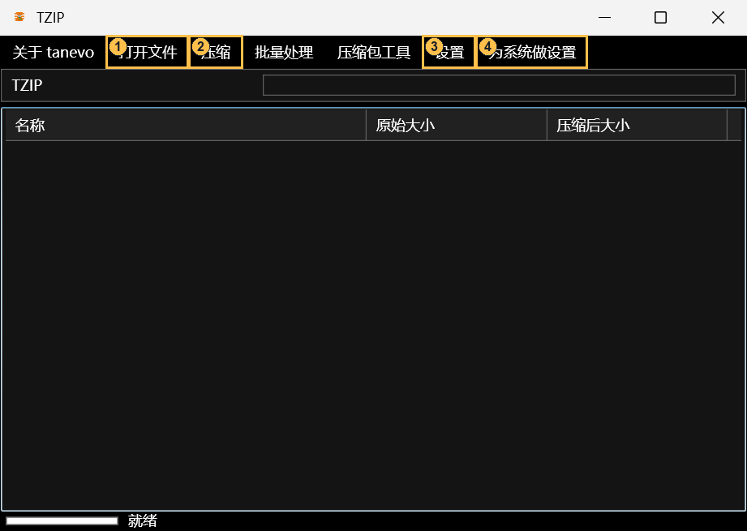
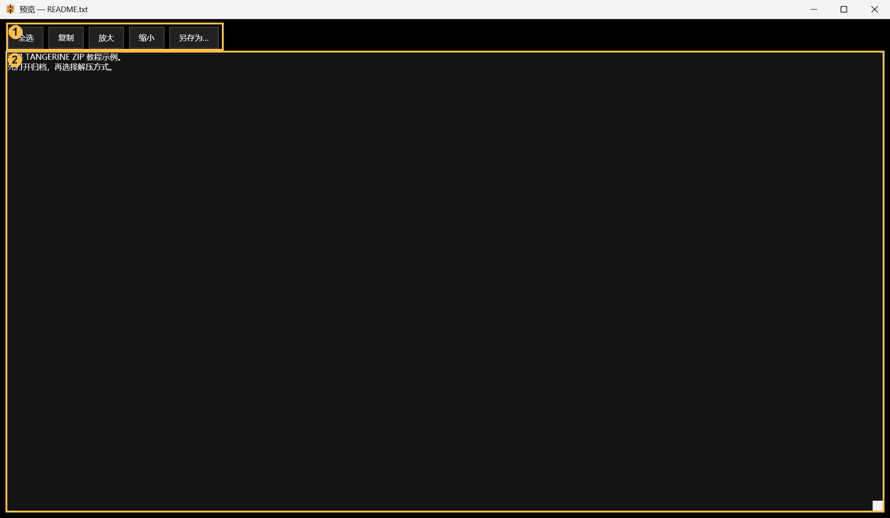
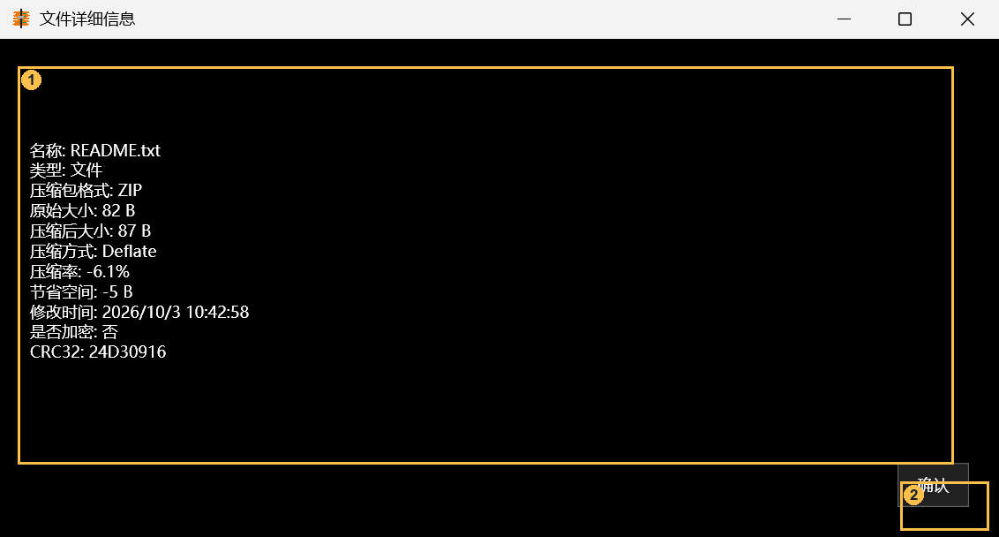
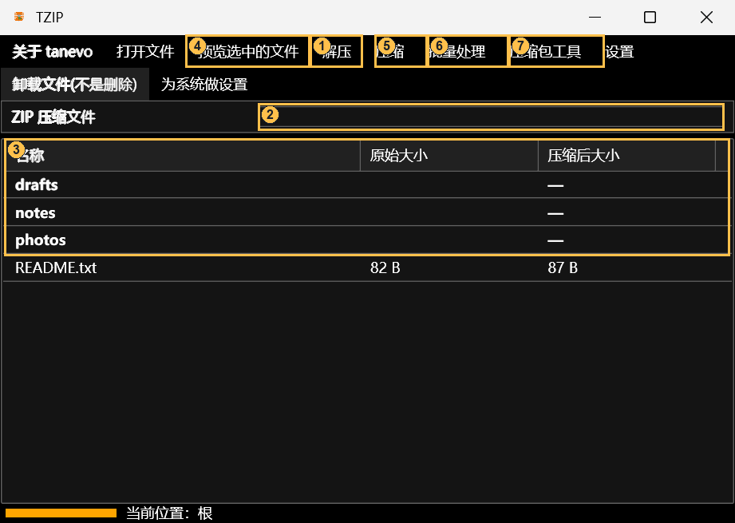
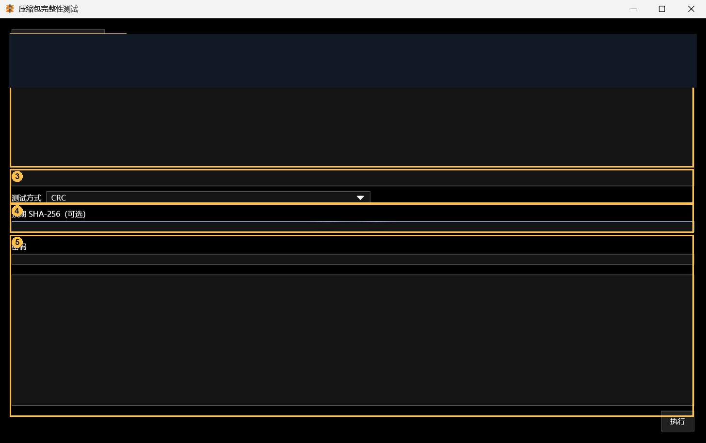
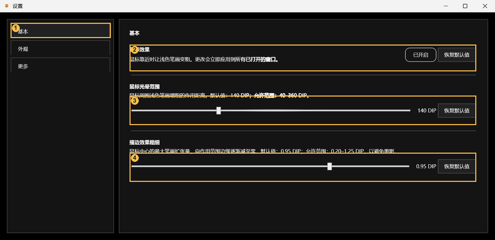
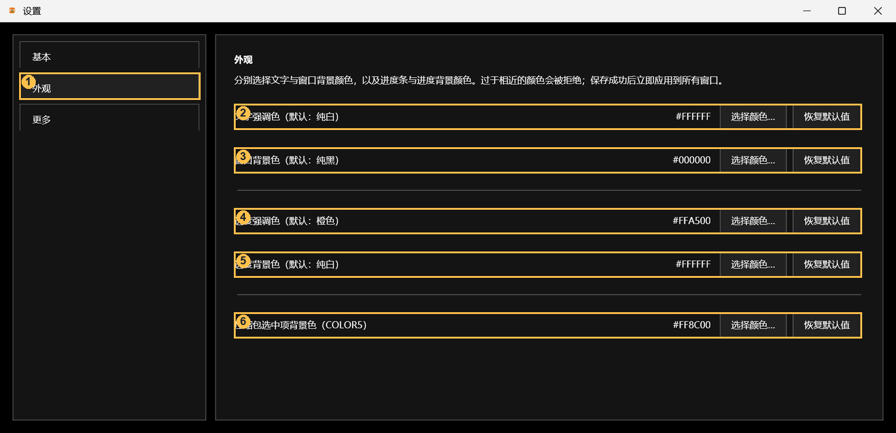
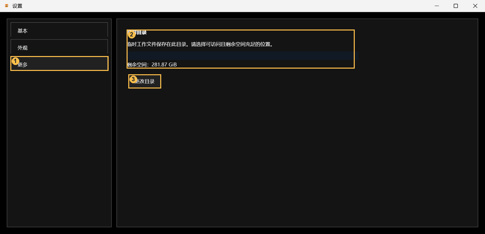
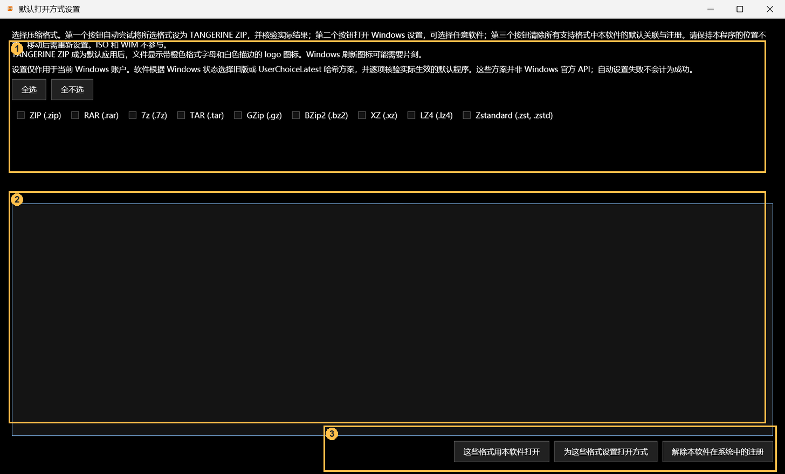

# TANGERINE ZIP 使用说明书

本文说明程序的安装、压缩、浏览、解压及其他功能。文中的文件和路径仅用于展示操作结果，不要求用户创建相同目录；可替换为自己的文件及目标路径。界面图为实际软件截图，图中数字对应正文中的功能说明。命令的完整参数见 [`command.md`](command.md)。

## 1. 这是一个什么项目

TANGERINE ZIP 是 Windows 桌面压缩包管理程序，同一个 `TANGERINE-ZIP.exe` 同时提供 WPF 图形界面和命令行。可以创建、打开、浏览、解压多种归档文件，也有成员搜索与预览、完整性测试、Hash、批量操作、密码管理和资源管理器集成等功能。项目目标框架为 `net10.0-windows`，主项目是 [`../TANGERINE-ZIP/TANGERINE-ZIP.csproj`](../TANGERINE-ZIP/TANGERINE-ZIP.csproj)，解决方案为 [`../TANGERINE-ZIP.slnx`](../TANGERINE-ZIP.slnx)。

| 类型 | 打开、解压 | 创建 | 主要限制 |
| --- | --- | --- | --- |
| ZIP、7z | 是 | 是 | 密码创建支持；加密或分卷包不能原地更新 |
| RAR | 是 | 条件支持 | 创建和追加需要用户自行取得官方 `rar.exe` 并放在 EXE 同目录 |
| TAR、ISO、WIM、ARJ、ACE、ARC | 是 | 是 | ACE 创建为存储模式；ARC 文件名限较短的 ASCII 平铺文件名 |
| GZ、BZ2、XZ、LZ4、ZSTD、LZip、Unix compress（`.Z`） | 是 | 是 | 单文件压缩流；创建时只接受一个普通文件 |

格式能力来自 `ArchiveCapabilities` 和归档服务；文件检测器能识别的其他类型不等于可作为压缩包打开。ISO 写入仅支持一个 El Torito BIOS 启动项，不生成 UEFI/USB 混合启动镜像。详细边界见[项目介绍](../README.zh-CN.md)和[密码归档说明](PASSWORD_ARCHIVES.md)。

## 2. 下载、首次启动

在 [GitHub Releases](https://github.com/xiaoxiaoSean/TANGERINE-ZIP/releases) 选择 Windows x64 版本：文件名以 `-sc.exe` 结尾的是自包含版；`-fd.exe` 是依赖框架版，须预装 [.NET 10 Desktop Runtime](https://dotnet.microsoft.com/download/dotnet/10.0)。当前 README 链接的正式版为 v2.1.1，预发布版为 tanevo v2.1.5.2；以发布页为准。

1. 把 EXE 放在**可写目录**后运行。配置文件保存在程序同目录，不建议直接从只读位置运行。
2. 第一次启动会要求选择存在、可写且有可用空间的临时目录。程序在该目录下使用专属的 `TZIP-WORKSPACE`，不会清空你所选父目录中的其他文件。以后可在“设置 → 更多”修改。
3. 首次启动可按提示配置系统集成；这是可选步骤。若要创建 RAR，请自行按官方许可取得 `rar.exe` 并放在程序同目录；浏览和解压 RAR 不依赖它。

若迁移 EXE，记得一并检查同目录配置及临时目录路径。损坏或不可达的临时目录会阻止需要归档工作进程的任务；CLI 可用 `temp set` 重新设置。

下图为程序空白主窗口的实际截图。橙色数字只标识软件画面内的入口：**① 打开文件、② 压缩、③ 设置、④ 为系统做设置**；首次运行的配置向导未出现在这张图中。



## 3. 示例文件与路径约定

为说明不同操作的输出路径，仓库提供以下示例文件，位于 [`examples/getting-started/`](examples/getting-started/)：

| 文件 | 内容 | 用途 |
| --- | --- | --- |
| [`tutorial-sample.zip`](examples/getting-started/tutorial-sample.zip) | `README.txt`、`notes/todo.txt`、`photos/caption.txt`、`drafts/keep.txt` | 说明浏览、搜索、预览和五种解压方式；包含显式目录条目。 |
| [`sources/`](examples/getting-started/sources/) | 与上述 ZIP 内容相同的源文件 | 说明创建归档时的输入目录与输出结构。 |
| [`nested-tar-sample.zip`](examples/getting-started/nested-tar-sample.zip) | `bundle.tar` → `inside/info.txt` | 说明嵌套 TAR 的显示与解压。 |
| [`single-file-sample.txt.gz`](examples/getting-started/single-file-sample.txt.gz) | 单个文本文件的 GZip 流 | 说明单文件压缩流与普通 ZIP 的区别。 |

以下假设归档和 `sources` 文件夹位于 `D:\TZIP-Lab\`，输出父目录为 `D:\TZIP-Lab\out\`。这两个路径只是示意，可替换为实际位置；不要将输出指向原始归档或需要保留的文件。如果使用仓库附带的示例，可将其复制到上述位置，也可直接打开仓库中的文件并自行指定输出目录。示例内容仅为文字，不含真实照片、账户资料或可执行文件。

## 4. 打开、浏览、搜索与预览

1. 在空白主窗口点击前图 **① 打开文件**，选择 `D:\TZIP-Lab\tutorial-sample.zip`。也可以把文件拖进空白窗口后点击出现的“打开拖动的压缩文件”；或以单个现存文件路径启动 EXE。打开成功后，根目录显示 `drafts`、`notes`、`photos` 和 `README.txt`。
2. 双击 `notes` 进入该目录，看见 `todo.txt`；通过“返回上一级”行回到根目录。目录可能是由包内文件路径推导出来的，不要求归档中一定存在独立目录条目。
3. 在搜索框输入 `todo`：列表显示匹配的**完整成员路径** `notes/todo.txt`。搜索忽略大小写，跨整个压缩包，而不只搜索当前目录；清空文本返回普通目录浏览。输入框在**未打开压缩包**时则用于过滤拖入的待压缩文件。
4. 选中根目录的 `README.txt`，点击“预览选中的文件”或双击它，打开文字预览窗口；文件夹不能这样预览。图片类型会打开图片预览，其余能够识别为文本的文件显示文字，否则会提示不支持。预览受可用内存限制，不是“打开任意文件”的通用查看器。
5. 右键某个成员可以查看详情、解压选中项，也可以在受支持的未加密非分卷包内复制、剪切、粘贴、删除。**编辑会修改归档并生成备份**；修改重要归档前应保留独立备份。顶部菜单“卸载文件(不是删除)”只清除当前窗口的打开状态，不删除磁盘上的 ZIP。



预览窗口标注：**①** 全选、复制、放大/缩小字号和“另存为”；**②** 只读的文本内容区。另存为会将原始成员写到指定位置，预览本身不修改归档。图片预览窗口另提供缩放、旋转和平移。



详细信息窗口标注：**①** 名称、类型、所属格式、原始/压缩后大小、压缩方式、压缩率、节省空间、修改时间、加密状态及可用的 CRC 等元数据；**②** 关闭窗口。很小的文件可能出现负压缩率，并非损坏。



图中：**① 解压**、**② 搜索框**、**③ 成员列表**、**④ 预览**、**⑤ 压缩**、**⑥ 批量处理**、**⑦ 压缩包工具**。画面显示打开 `tutorial-sample.zip` 后的根目录。

## 5. 解压选项与输出位置

菜单的五个常规选项区别在于**解压范围**（全部或选中）、**是否创建与归档同名的子目录**及**目标目录如何确定**。下表假设打开的是 `D:\TZIP-Lab\tutorial-sample.zip`；所列目录为输出路径示例，不是程序要求的固定目录。“选择目录”表示操作时会打开目录选择器，**“直接”不表示免选目录**。

| 菜单选项 | 需要先选成员？ | 选择目录？ | 输出位置示例 |
| --- | --- | --- | --- |
| **直接解压全部** | 否 | 是 | 选择 `D:\TZIP-Lab\out\all\` → `all\README.txt`、`all\notes\todo.txt`、`all\photos\caption.txt`、`all\drafts\keep.txt`；**不额外建同名文件夹**。 |
| **全部解压到文件夹** | 否 | 是 | 选择 `D:\TZIP-Lab\out\folder\` → 先建 `folder\tutorial-sample\`，四个成员都在其下。 |
| **解压到压缩文件所在文件夹** | 否 | 否 | 包位于 `D:\TZIP-Lab\` → 输出 `D:\TZIP-Lab\README.txt` 和 `D:\TZIP-Lab\notes\todo.txt` 等，**不建** `tutorial-sample` 子目录。注意确认包所在目录是否已有同名文件。 |
| **直接解压选中的** | 是 | 是 | 在根目录选中 `README.txt`，选择 `D:\TZIP-Lab\out\one\` → 仅有 `one\README.txt`。也可选 `notes` 目录，该目录下的 `todo.txt` 会随之解出。 |
| **解压选中的到文件夹** | 是 | 是 | 选中 `notes`，选择 `D:\TZIP-Lab\out\selected\` → `selected\tutorial-sample\notes\todo.txt`；`README.txt` 不会出现在该输出中。 |

**选中项的操作细节：**先在列表点选条目；可用 Ctrl/Shift 多选。目录条目包括其后代；未选中时会提示并不开始任务。若当前列表处于搜索状态，选择的仍是对应的包内完整路径。包名取文件名的**最后一个扩展名前**部分，例如 `tutorial-sample.zip` 对应 `tutorial-sample`；`.tar.gz` 之类的文件按其最后一个后缀处理，实际结果请看目录选择后的目标。

**覆盖与安全：**目标存在同名文件时会显示文件名和目标位置，提供“仅这次覆盖 / 仅这次跳过 / 全部覆盖 / 全部跳过 / 取消任务”；遇到危险路径、异常体积或成员读取失败另有安全提示。使用“全部覆盖”前确认现有文件不需要保留。程序阻止解压时覆盖正在打开的归档本身。取消或强制停止并不自动恢复已覆盖的文件，也可能留下部分结果。操作前应确认输出路径和可用磁盘空间。

**嵌套 TAR：**以 `nested-tar-sample.zip` 为例，该包只有一个 `bundle.tar`，程序会**自动展开并显示其内的 `inside/info.txt`**，因此列表未必先显示 `bundle.tar`。检测到嵌套 TAR 时才出现“**TAR 嵌套一键解压**”；对于自动展开的单 TAR，不需选中 TAR，直接选择目标目录。普通解压与一键解压的目标层级可能不同；一键解压会以外层包名和内层 TAR 名分别建目录，例如 `out\nested\nested-tar-sample\bundle\inside\info.txt`。包含多个 TAR 的归档不会自动展开，此时须先选中要一键解压的 TAR 条目。普通 ZIP 不显示此菜单。单文件 GZip 示例打开时按一个虚拟条目显示，并非包含多个可选成员。

## 6. 创建压缩包与压缩选项

在空白主窗口点击 **② 压缩 → 选择要压缩的文件**，选择要打包的文件；此文件选择器用于选择文件。要包含一个完整目录，可将文件夹从资源管理器拖入空白窗口，在待压缩列表确认来源，然后点击“创建一个新压缩文件”。指定输出路径并在保存对话框选择格式；格式依据所选过滤器，而不是仅凭输入的扩展名。若输出已存在，保存对话框会询问覆盖。确认压缩选项并等待进度完成后，可用“打开文件”查看新包。以整个 `sources` 文件夹为输入时，新包以 `sources/` 为顶层目录；这与示例 `tutorial-sample.zip` 的根目录结构不同。

- **普通 ZIP**：不勾选密码、不展开高级选项，即使用格式默认参数。微小文本文件可能出现“压缩后大小比原始大小大”，并非创建失败。
- **密码**：仅 ZIP、7z、RAR 可创建原生密码包；密码输入限制为可打印 ASCII。密码管理器保存在 Windows 凭据管理器。非这些格式的密码入口禁用。
- **高级压缩**：仅 ZIP、7z、RAR；可以设置等级、方法、字典、线程、内存、分卷、排除规则，7z/RAR 有固实模式，RAR 有恢复记录。RAR 创建/追加要求 EXE 旁的官方 `rar.exe`。方法/等级与格式必须匹配；较大字典或分卷会增加资源消耗和兼容风险，不确定时保留默认值。
- **配置方案**：可保存和载入高级参数，**不会保存密码**。ISO 则打开独立的 ISO 文件系统/启动设置窗口；GZ、BZ2、XZ、LZ4、ZSTD、LZip 和 `.Z` 等单文件流只能从一个普通文件创建，不要直接把整个 `sources` 目录指定给它们。
- **向现有压缩包添加文件**：打开普通 ZIP/7z（或已配置官方 RAR 工具的 RAR）后，“压缩”中出现“添加文件到压缩包”。所选文件添加到包根，同名成员可能被替换；程序先确认并在修改时保留备份。不适用于加密、分卷等不符合条件的包。

## 7. 批量处理、压缩包工具、设置与系统集成

下表列出其他菜单入口及使用限制。对现有归档进行编辑、转换或修复前，建议先备份原文件。

| 入口 | 怎么用、会发生什么 |
| --- | --- |
| **批量处理 → 批量解压** | 多选几个归档，选择输出父目录和输入密码（如需要）。每个包输出为独立同名目录；已存在目标会被拒绝，不会自动合并。前一个包成功、后一个失败时，已完成的结果仍保留。 |
| **批量处理 → 格式转换** | 多选输入、选择输出目录，再选 ZIP、7z 或 TAR；先解压到独立暂存区再创建新包。输出密码只支持 ZIP/7z，TAR 不支持。转换前检查空间及同名输出。 |
| **压缩包工具 → 创建自解压 EXE** | 可选当前包或另选本软件能打开的包；输出新的 Windows `.exe`，内部转换为 7z 并附加 SFX 模块，不会修改源包。别执行来源不明的 EXE；这与一般 ZIP 解压不是一回事。 |
| **完整性测试** | 选择一个或多个包，按 CRC/成员读取、SHA-256 对比或数据块读取模式执行；Hash 比对需给期望值。报告坏成员不代表已经修复。 |
| **损坏探测与修复** | 在副本上尝试恢复可读成员，先阅读风险提示；无法保证恢复全部内容。 |
| **Hash 显示和校验** | 选文件及 SHA-256/SHA-512/MD5，显示计算值；填入期望值可比较。Hash 相符仅说明文件内容一致，不等于来源可信。 |
| **Microsoft Defender 扫描** | 对当前包调用系统 Defender；仅在安装且启用 Defender 时可用。扫描失败不能当作“安全”。 |
| **创建快照** | 为当前归档选择目标目录，创建经 SHA-256 校验的独立副本；GUI 默认不自动清理旧快照。修改包前可先做一次。 |
| **乱码修复/切换编码** | 用其他文件名编码重新读取有乱码的归档；先确认压缩包原本的编码，不会凭空修复已经损坏的数据。 |
| **ZIP 注释** | 仅打开 ZIP 时显示；可查看或修改归档注释，写入时创建原包备份。 |
| **密码管理器** | 查看、保存或删除供本程序使用的归档密码，凭据保存在 Windows 凭据管理器。 |
| **设置** | “更多”修改 `TEMP_D` 指向的临时目录；“外观”管理主题颜色及鼠标效果，基本页提供其他常规项。配置写在 EXE 所在目录，先确保可写。 |
| **为系统做设置** | 创建或删除 Explorer 右键菜单；“默认打开方式设置”注册关联并尝试设置默认程序。Windows 11 现代菜单可能需要 UAC 和签名包；Windows 可阻止自动改写默认关联，届时到 Windows 设置手动选择。单独使用压缩或解压功能无需安装系统集成。 |



完整性窗口标注：**①** 选择一个或多个包；**②** 已选文件列表（图片已遮盖本机路径）；**③** CRC、SHA-256 或数据块读取方式；**④** 期望 SHA-256（仅相应方式使用）；**⑤** 密码与测试报告。点击右下方“执行”开始，报告列出问题成员；这不是修复按钮。



基本页标注：**①** 基本页；**②** 鼠标白色加粗效果开关；**③** 光晕范围滑块；**④** 描边粗细滑块。每项右侧可恢复默认值，调整后应用于当前软件窗口。



外观页标注：**①** 外观页；**②** 文字强调色；**③** 窗口背景色；**④** 进度强调色；**⑤** 进度背景色；**⑥** 压缩包选中项背景色。每行有颜色选择和恢复默认值；颜色对比度不足时会拒绝保存。



更多页标注：**①** 更多页；**②** 临时目录说明及剩余空间（本机路径已遮盖）；**③** 更改目录。新目录需要存在、可写并满足空间检查；程序仅管理该目录中的专用工作子目录。



默认打开方式窗口标注：**①** 选择格式（含全选/全不选）；**②** 当前任务的记录区域；**③** 注册所选格式、打开 Windows 默认应用设置或解除本软件注册的操作按钮。关联属于当前 Windows 账户，Windows 可能拒绝自动切换默认应用；不要把“已注册”视为“已设置为默认”。

主窗口任务运行时会显示“停止工作”。确认强制停止后会终止工作进程；这可能留下未完成的解压结果或临时文件，不会撤销覆盖。工具窗口也有自己的任务和取消控制，主窗口按钮不是全局停止键。

## 8. 命令行用法示例

在 PowerShell 中切换到 EXE 所在目录后运行。先确保 `D:\TZIP-Lab\` 中已有示例包，并创建临时目录（`temp set` 不会替你创建不存在的目录）。下面把 `sources` 整个文件夹压成一个**新包**，再列出和解压；若 `my-copy.zip` 已存在，换个输出文件名：

```powershell
.\TANGERINE-ZIP.exe help
New-Item -ItemType Directory -Force "D:\TZIP-Lab\temp" | Out-Null
.\TANGERINE-ZIP.exe temp set "D:\TZIP-Lab\temp"
.\TANGERINE-ZIP.exe compress "D:\TZIP-Lab\my-copy.zip" "D:\TZIP-Lab\sources"
.\TANGERINE-ZIP.exe list "D:\TZIP-Lab\my-copy.zip"
.\TANGERINE-ZIP.exe extract "D:\TZIP-Lab\my-copy.zip" "D:\TZIP-Lab\out\cli-all"
```

下列命令分别展示“列出全部”“只提取文件”和“只提取文件夹”（示例 ZIP 所在位置按需替换）：

```powershell
.\TANGERINE-ZIP.exe list "D:\TZIP-Lab\tutorial-sample.zip"
.\TANGERINE-ZIP.exe extract "D:\TZIP-Lab\tutorial-sample.zip" "D:\TZIP-Lab\out\cli-one" --entry "README.txt"
.\TANGERINE-ZIP.exe extract "D:\TZIP-Lab\tutorial-sample.zip" "D:\TZIP-Lab\out\cli-notes" --entry "notes/"
```

`cli-one` 只含 `README.txt`；`cli-notes` 含 `notes\todo.txt`。命令行 `--entry` 要与列出的成员键**精确一致**：这里的 ZIP 特意包含显式目录 `notes/`；并不是所有第三方 ZIP 都有可直接指定的目录条目。GUI 可以根据子成员显示文件夹。CLI 解压遇到已有目标文件默认终止，GUI 则弹出覆盖选择。

无参数打开 GUI；只给一个**已存在文件**的路径会在 GUI 打开该文件。命令行帮助、状态及错误为英文；`help` 不要求事先配置临时目录，其余归档命令一般需要 EXE 同目录的 `TEMP_D` 指向有效临时目录。`compress` 拒绝已存在的输出，`extract` 默认遇到覆盖冲突即中止。命令行还包括 `add`、`batch-extract`、`convert`、`sfx`、`test`、`hash`、`repair`、`snapshot`、`integration` 等；不要猜测选项，使用 `help <command>` 或阅读[完整命令行手册](command.md)。CLI 在无现成终端时不会另开控制台；脚本需要可靠等待退出时参阅[进程启动说明](WINDOW_LAYOUT_AND_PROCESS_STARTUP.md)。

## 9. 从源码构建与阅读

在 Windows x64 上安装 .NET 10 SDK，打开仓库根目录的终端：

```powershell
dotnet restore .\TANGERINE-ZIP.slnx
dotnet build .\TANGERINE-ZIP.slnx -c Release --no-restore
```

也可在支持 `.slnx` 的 Visual Studio 中打开解决方案。项目默认启用 WPF、Windows Forms 和 `win-x64` 自包含单文件发布属性；`build` 生成开发构建，**不等同于** `publish` 的单文件交付。要制作分发包，请核对发布参数、原生依赖、许可证和目标机器上的实际运行情况；Windows 11 原生右键菜单的源码/打包脚本位于 `TANGERINE-ZIP.ContextMenuPackage/`，修改后还需要重新生成并签名嵌入式 MSIX，不能只重编译主程序。第三方原生/许可证资料在 `third_party/`。

建议按以下顺序追踪调用：

1. [`App.xaml.cs`](../TANGERINE-ZIP/App.xaml.cs) → [`WpfStartup.cs`](../TANGERINE-ZIP/WpfStartup.cs)：WPF 入口；先分流证书助手、归档工作进程、CLI、资源管理器操作，再处理首次启动和主窗口。
2. [`MainWindow.xaml`](../TANGERINE-ZIP/MainWindow.xaml) / [`MainWindow.xaml.cs`](../TANGERINE-ZIP/MainWindow.xaml.cs)：菜单、列表、搜索、拖拽、进度和交互；其他 `*Window.xaml(.cs)` 是对应功能窗口。
3. [`Services/ArchiveWorker.cs`](../TANGERINE-ZIP/Services/ArchiveWorker.cs)：同一 EXE 的后台实例，通过 JSON 管道传递请求、进度、冲突回答和结果；GUI/CLI 的耗时归档操作使用这一边界。
4. [`Services/ArchiveService.cs`](../TANGERINE-ZIP/Services/ArchiveService.cs)、[`Services/ArchiveModels.cs`](../TANGERINE-ZIP/Services/ArchiveModels.cs)：列出、创建、解压的核心逻辑，格式能力、覆盖及安全决策；[`Tools/FileDetector.cs`](../TANGERINE-ZIP/Tools/FileDetector.cs) 检测输入内容。ZIP/7z/RAR 的某些写入路径另经 `EncryptedZipService`、`SevenZipToolService`、`RarToolService`。
5. [`Services/CommandLine.cs`](../TANGERINE-ZIP/Services/CommandLine.cs)：公开命令解析、校验、错误和退出码。系统集成见 `Services/ContextMenu*`、`DefaultApp*`；临时空间见 [`Services/TempDirectorySettings.cs`](../TANGERINE-ZIP/Services/TempDirectorySettings.cs) 和 `ResourcePreflight.cs`。

多语言文本在 `LanguageManager/UiStrings*.resx`；新增面向用户的消息应遵循本地化约定。错误用 `StageException` 携带阶段代码，代码清单在 [`../TANGERINE-ZIP/Resources/StageList.txt`](../TANGERINE-ZIP/Resources/StageList.txt)。已有的[开发文档索引](README.md)、[GUI/CLI 对照](CLI_GUI_PARITY.md)与[功能逻辑总览](function_and_logic.md)可供进一步阅读；若旧文档和当前代码有差异，以当前代码为准。

## 10. 验证与排查

修改归档逻辑后，至少运行 Release 构建，并在 Windows 上以实际文件做一次“创建 → 列出 → 解压 → 核对内容”的回归；按改动补测密码、覆盖、取消、异常路径和目标格式。仓库解决方案目前仅包含主应用项目，未包含自动化测试项目。CLI 报错会写入标准错误，通常带阶段代码；结合 `StageList.txt` 定位入口，再顺着工作进程与服务调用追踪。不要把一次编译成功等同于 Windows 资源管理器集成、MSIX 安装或目标机器上的格式兼容性验证。
